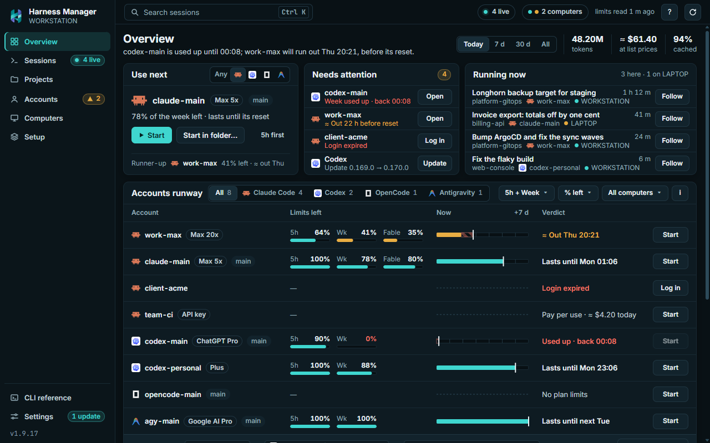

<div align="center">


# Harness Manager

**Run Claude Code, Codex, OpenCode, Antigravity, Pi and Oh My Pi under several accounts on one computer, side by side.**<br>
See every account's limits, usage and sessions in one window, and keep one set of MCP servers, skills and
prompts for all of them.

[](https://github.com/abushanab-net/HarnessManager/releases/latest)
[](https://github.com/abushanab-net/HarnessManager/releases)
[](https://github.com/abushanab-net/HarnessManager/actions/workflows/ci.yml)
[](LICENSE)


[Install](#install) · [Quick start](#quick-start) · [Features](#features) · [Supported tools](#supported-tools) ·
[Command line](#command-line) · [FAQ](#faq) · [Contributing](#contributing)



</div>

## Why

Tools like Claude Code keep one login per settings folder. With a work subscription, a personal one and an
API key, switching means logging out and in, and you lose track of which account still has room.

- **One folder per account.** Every account runs in its own folder, so several run in parallel and nothing
  global changes.
- **Know where the room is.** The 5-hour and weekly limits of every account, when they free up, and which
  account to start next.
- **One place for your setup.** MCP servers, skills and prompts are kept once and written into every tool
  in that tool's own format.
- **A window and a CLI.** The desktop app and `hrm` run the same operations from one core library; most `hrm`
  commands take `--json` for scripts.

## Install

Download the installer from the [latest release](https://github.com/abushanab-net/HarnessManager/releases/latest).

| System | File | Notes |
|---|---|---|
| **Windows 10/11** | `Harness.Manager_<version>_x64-setup.exe` | The primary platform, tested on every change. Installs `HarnessManager.exe` and `hrm.exe` for the current user. |
| Windows on ARM | `Harness.Manager_<version>_arm64-setup.exe` | Cross-compiled on the x64 release runner, as an experimental build: when it fails, the release goes out without it. Not tested on an ARM device. |
| macOS | `Harness.Manager_<version>_<arch>.dmg` | Built on the release Mac; the core passes its tests on macOS, the app is not tested there. Signed with a Developer ID and notarized when the release has the Apple signing secrets, otherwise signed ad hoc (macOS then asks for Open Anyway at the first start). |
| Linux | `.AppImage` or `.deb` | Built on the release Linux runner; the core passes its tests on Linux, the app is not tested there. |

The Windows installers are not code-signed, so Windows SmartScreen shows a warning the first time one is run:
choose More info, then Run anyway.

What macOS and Linux lack today: launch at sign-in is Windows only, switching Antigravity between accounts is
Windows only (there Antigravity runs as its one account), and on Linux a new terminal opens through
`x-terminal-emulator` alone.

Silent install on Windows:

```powershell
& ".\Harness.Manager_<version>_x64-setup.exe" /S /D="$env:LOCALAPPDATA\Harness Manager"
```

The app updates itself: it checks for a new version at launch and every hour, and installs only updates
signed by the release key.

### Use hrm in a terminal

- On **Windows**, Setup adds the install folder to your user PATH. Open a new terminal from the Start menu
  and run `hrm --version`. Uninstall removes the entry added by Setup.
- The **Linux .deb** installs `/usr/bin/hrm`. The package manager removes it with the app.
- On the first **AppImage** launch, the app copies `hrm` to `~/.local/bin/hrm`. It refreshes the copy
  when you start a different version. Most Linux distributions include `~/.local/bin` on PATH.
  If your shell needs it, add that folder to its PATH. Use **Settings → Window → Remove** before
  deleting the AppImage, or remove the copied file yourself.
- On **macOS**, drag Harness Manager into Applications and open it there. The first time, choose **Add**
  to link `/usr/local/bin/hrm` to the app. macOS asks for an administrator password. **Not now** skips
  the offer. You can add or remove the link later in **Settings → Window**. If you already trashed the app,
  check that `/usr/local/bin/hrm` points to Harness Manager, then run `sudo rm /usr/local/bin/hrm`.

The **hrm on the PATH** row in Settings shows whether a new terminal finds this copy of `hrm`.

## Quick start

1. **Start Harness Manager.** It adds a main account for each tool it finds installed.
2. **Accounts → Add account:** name it, pick the tool and sign in. Claude accounts sign in inside the app.
3. **Start** opens a terminal as that account. **Start in folder…** picks a project first.
4. **Overview** says which account to use next, which accounts need attention, what runs now, and draws
   every account's limits on one lane from now to seven days ahead.
5. **MCP servers**, **Skills** and **System prompts:** add something once and tick the tools it should reach.

`Ctrl K` opens the command palette: start an account, run an action, or go to a page, an account, a
session or a setting. `/` puts the cursor in the search box, which searches sessions or filters the page
you are on. The **?** button replays the page's tour.

## Features

- **Accounts per tool, each in its own folder:** Claude Code (`CLAUDE_CONFIG_DIR`), Codex (`CODEX_HOME`),
  OpenCode (`XDG_CONFIG_HOME` / `XDG_DATA_HOME`), Pi and Oh My Pi (`PI_CODING_AGENT_DIR`) accounts run in
  parallel. Antigravity keeps one login, so starting another Antigravity account swaps the saved login (on
  Windows). Accounts can be renamed and are grouped by tool.
- **Limits:** Claude limits come from the numbers Claude Code saves, and can optionally be read live with
  the saved login while it is valid. Codex limits come from its session logs. Antigravity's come from `agy -p /usage`, which
  reports only the account signed in now; the other Antigravity accounts keep their last reading. The Overview
  draws when every limit frees up, and an API-key account can have a daily spending cap.
- **Resets and credits:** see what Codex and Claude Code report in Limits, and open the tool or its Usage page to manage them.
- **Usage, on Accounts:** each account's tokens per day, its tokens and cost for the last 7, 14 or 30 days
  beside its limits, the split by model, and a CSV export; the Overview adds a year of activity and the latest
  replies, with the request log behind a button. Each account's own logs are read once and counted once.
- **Projects:** every folder your tools ran in, as one list: sessions, tokens and cost at API list prices,
  each project's share, and what runs there now. Pin a project to the sidebar; open one to see only its
  sessions.
- **Sessions:** every tool's sessions in one place, with one filter line, the running ones on top, and groups by
  project, date, account, tool or tag. Tag sessions and projects with your own labels. A reading view shows the
  steps, failed commands, answers and changed files, and follows a running session live. Resume reopens a
  session in its own account.
- **Needs you:** a Claude Code session started from Harness Manager says whether it is working, waiting for you
  or done, through a hook it is started with (`hrm settings session_hooks false` turns it off). The hook comes
  from a file in Harness Manager's own folder: no account's files change, and sessions started elsewhere are not
  touched. A session that waits for a permission or an answer shows on the Overview, on its row, in the tray and
  in a message, and Show brings its terminal to the front. A permission request or a question can be answered on
  the Overview (approve once, deny, or one of the question's options) while the terminal prompt stays answerable;
  after `request_seconds` (5 minutes) only the terminal answers it. A Claude subscription account can also start with
  Claude Code's own Remote Control.
- **MCP servers, skills and prompts, kept once:** each MCP server is written into every tool you tick.
  Skills live once in `~/.agents/skills` and are linked into each tool; Discover installs skills from
  GitHub repositories. A ledger records what Harness Manager wrote, so it only ever removes its own entries.
  A switch on System prompts (`hrm settings agent_hint true`; off by default) adds a short block to the end of
  every account's prompt file, between Harness Manager's own marks: how an agent reads `hrm list`, and that it
  uses another account only when you allow it. Off takes the block out; your own text is never changed.
- **Apps:** every copy of each tool on this computer and how it was installed (the vendor's installer, npm,
  winget, Homebrew, Scoop or Chocolatey), its version and the newest one from its vendor, and install, update
  or remove a duplicate copy in a terminal you can watch.
- **API keys and a local router:** API-key accounts keep their key in the system credential store (see the
  FAQ), and only the launched process receives it. A local router on 127.0.0.1 sends routed accounts to
  providers, moves to the next one when a provider fails, and converts between the Anthropic Messages and
  OpenAI Chat Completions formats. Subscription logins never pass through it. DeepSeek is a built-in preset
  (`hrm provider list` shows the command that adds it): its OpenAI-format endpoint, its Anthropic-format one
  for Claude Code routes, both models and their list prices, with cache hits counted from the usage it returns.
  Codex can be routed as well, to a provider that serves `/responses`: the router passes its requests on
  unchanged. An API-key account of Claude Code or Codex that points at an endpoint of your own (a gateway, a
  local model server) goes through the router by itself, with no provider or route to set up; a plain vendor
  key still goes straight to the vendor. Such an account can have the line its tool names itself with ("You
  are Claude Code, ...") removed or replaced. Only that line changes: the rest of the instructions stays,
  because it tells the model how to use the tools.
- **Backups:** automatic and manual, of the account list, settings, what Harness Manager wrote into each
  tool, and the skills it manages. Backups never hold keys, logins or MCP env and header values. A backup also
  holds the history: every request with the computer it ran on and the cost it was valued at, the sessions, the
  limit readings, the tags, the other computers (names and certificates, never keys) and the archived sessions;
  with Include transcripts on, this computer's session transcripts too. With a sync folder chosen, every
  backup is also copied to `backups\<this computer>` there, so a fresh computer finds its history beside the
  journal. **Restore is a merge:** Settings › Backups › Restore… takes a backup (this computer's or one from
  the sync folder), the sync folder itself, or a zip or folder from elsewhere, shows what it holds (computers,
  requests, tokens, sessions, limit history, archived transcripts, the newest date) and merges it by the same
  rules sync uses, so nothing is counted twice and restoring again adds nothing. When the source names this
  computer, "Restore and continue as <name>" takes over that identity (its id, a new incarnation, so the other
  computers see a continuation); otherwise the restored computer stays a past computer in the lists. **The
  archive** moves the transcripts of sessions older than an age you choose (30 days by default; Never keeps
  everything where it is) out of the tools' folders into `archive\<this computer>` in the sync folder and into
  a folder of your choice, compressed, each copy checked before the original is deleted, once a day while the
  app runs and with Archive now. The session stays in the list with an "archived" pill and its numbers, and
  reads from the archive; it cannot be resumed from there. Usage is never touched. **Welcome back:** when a
  sync folder is chosen and it holds history, the app offers to restore it and continue as the computer of
  that name, to restore it as a new computer, or to start fresh.
- **Computers:** the Computers page connects your computers in up to three ways. **A shared folder**
  (OneDrive, Google Drive, SMB, a NAS): each computer publishes its usage, sessions, limit readings and tags
  there as an append-only journal, which the others merge into their own database. Every request keeps its id
  and the cost it was valued at, so nothing is counted twice and nothing is re-priced. The page shows a card
  per computer with how it is reached and when it was last heard from; Sync now runs a round at once. With sync
  on, the Overview adds every computer up and gets an "All computers · This computer" switch, Sessions gain a
  Computer filter (a session open elsewhere says "running on <name>"), and a chip in the top bar shows which
  computers were heard from recently. With sync off, nothing changes.

  **Direct connection:** turn on Connect directly and two computers talk to each other straight over the
  network, so what runs on each and new history arrive within seconds instead of a folder round. Pair them once
  with a six-digit code (Pair a computer… shows it on one computer and takes it on the other, with an address
  for a computer on another network); each then holds the other's certificate, and every connection is mutual
  TLS that only paired computers can open. They find each other by mDNS on the same network; across a VPN give
  the computer's card an address, a stable name or IP. Journal chunks are signed by the computer they come
  from, and a computer reachable only through another paired computer is relayed. Forget removes a computer
  and its certificate (what was merged from it stays).

  **A hub you host:** the other choice beside the folder: a small service on a VPS behind Caddy, in Docker
  (`deploy/hub/`), that every computer pushes its journal to and pulls the others' from, with presence,
  transcripts and the addresses the direct connection meets at, from any network and without a VPN. The first
  computer joins with the hub's admin token (Computers › A hub you host › Join with a code…) and makes the
  **ring key** that seals everything before it leaves: chunks, presence and transcripts reach the hub as
  ciphertext the hub cannot open, and only the signed device records (names, ids, keys, project roots) are
  plain. The key is shown once as the **recovery key**, 8 groups of 4 letters and digits for your password
  manager; the hub's ⋯ menu shows it again. Every other computer joins with a one-time six-digit code from
  Invite a computer… on a computer already there, and reads the hub either because it was paired directly (the
  pairing carries the ring key) or after Enter the recovery key…. While the app runs it keeps the hub's events
  socket open and pulls on each change, falling back to a round every 30 s. What the hub can see: who the
  computers are, how much each sent and when. What it cannot: a single request, session, prompt or transcript.
  [deploy/hub/README.md](deploy/hub/README.md) sets one up.

  **Resuming elsewhere.** With Carry transcripts on, each computer also shares its session transcripts
  (compressed; a transcript over 20 MB stays home, and up to 200 MB per computer is kept, the oldest going
  first). A session from another computer can then be read here, fetched the first time, and resumed here
  with **Resume here** when this computer has the same repository and an account of that name for that tool;
  otherwise the row says why. Resuming is a fork: the transcript is copied where the tool looks for it here
  (Claude Code is started with `--resume <copy> --fork-session`, Codex with `-C <clone> resume <id>`, OpenCode
  imports the export, Pi and Oh My Pi get the log under their sessions folder; Antigravity is read-only) and
  the original on the other computer is never written. Only the conversation comes across: files changed since,
  attachments and running shells do not, so pull the branch first.
- **Desktop comforts:** closes to the tray, with every account's limit rings a click on the tray icon away;
  launches at sign-in (Windows); dark, light or as the system is; three text sizes (Settings › Appearance);
  a diagnostic log; and a guided tour of each page.

## Supported tools

| | Claude Code | Codex | OpenCode | Antigravity | Pi | Oh My Pi |
|---|:---:|:---:|:---:|:---:|:---:|:---:|
| Several accounts at once | ✓ | ✓ | ✓ | one at a time | ✓ | ✓ |
| Subscription login | ✓ | ✓ | ✓ | ✓ | `/login` in the tool | `/login` in the tool |
| API-key account | ✓ | ✓ | | | ✓ | |
| Through the local router | ✓ | | | | ✓ | |
| Limits | 5-hour and weekly | 5-hour and weekly | | the signed-in account's | | |
| Tokens and cost | ✓ | ✓ | ✓ | | ✓ | ✓ |
| Sessions | ✓ | ✓ | ✓ | ✓ | ✓ | ✓ |
| MCP servers and skills | ✓ | ✓ | ✓ | ✓ | ✓ | ✓ |
| Prompt file | `CLAUDE.md` | `AGENTS.md` | `AGENTS.md` | `AGENTS.md` | `AGENTS.md` | `AGENTS.md` |

Pi and Oh My Pi share one session format, so one parser reads both; each account is its own
`PI_CODING_AGENT_DIR`.

**DeepSeek Harness (`dsh`)** is not supported yet. It runs as a desktop app, a web UI or headless, and does not
document where it stores sessions or in what format, so there is nothing stable to read; its session logs are
also uploaded to DeepSeek by default. It will be revisited when its session store is documented. DeepSeek's
models are available today through the router preset above.

To add a tool, write an adapter in `crates/core/src/harness/` next to `claude.rs` and `codex.rs`.

## Command line

`hrm` runs the same operations as the window. Commands that print data take `--json`; `hrm help <command>`
shows each one's options.

```text
Accounts
  hrm list [--refresh]                       accounts with plan, limits, tokens and open consoles
  hrm show <account>                         one account in detail
  hrm add <name> [--harness codex] [--email alex@example.com] [--api-key | --route <id>] [--no-login]
          [--base-url <url>] [--model <id>] [--intro <text>]   an API-key account's own endpoint (below)
  hrm login <account>                        sign an account in
  hrm remove <account> [--delete-home]       remove it, and with --delete-home its folder
  hrm key set|delete <account>               the API key of an API-key account
  hrm init                                   add a main account for each installed tool
  hrm import [<path>]                        accounts of the old claude-accounts.ps1 launcher
  hrm harnesses                              the supported tools and which are installed

Running
  hrm run <account> [-- <args>]              the tool as that account, in this console
  hrm start <account> [--cwd <folder>]       the same, in a new terminal
  hrm open                                   the desktop app

Limits and usage
  hrm quota <account> [--live]               an account's limits; --live asks now (Claude, Antigravity)
  hrm usage [--days 7] [--profile <account>] tokens per account and day
  hrm overview [--days N] [--harness <id>]   cost at list prices, requests, tokens, cache hit rate
  hrm requests [--days N] [--limit 30]       every model response, newest first

Sessions and projects
  hrm sessions [--group project|date|account|tool] [--open] [--project <key>] [--tag <tag>] [--search <text>]
  hrm session <account> <id>                 one session as a transcript
  hrm resume <account> <id> [--cwd <folder>] reopen a session in a new terminal
  hrm tag session|project <key> [<tags>…]    set the tags (none clears them)
  hrm tags                                   every tag and how often it is used
  hrm projects list|rename|merge|reset       the projects and their names
  hrm index status|refresh [--all]           the session index the pages read

Shared setup
  hrm sync [--relink]                        bring every account in step
  hrm mcp list|add|remove|enable|disable|import
  hrm skills list|install|remove|enable|disable|import|check
  hrm prompts list|add|enable|show

Router
  hrm provider list|add|remove               endpoints and their keys
  hrm route list|add|remove                  failover or aggregate routes
  hrm router serve|status|stop|log|models    the local router

Computers
  hrm computers status|now|set|pair|join|peers|forget|serve
  hrm transcripts                            transcripts carried and known from the other computers
  hrm resume-here <computer>/<tool>/<account>/<id> [--cwd <folder>]
  hrm hub join <url> --code <c> | --admin    --admin asks for the token (in a script: --admin <token>)
  hrm hub invite|status|leave
  hrm ring show|enter [<key>]                the recovery key

Upkeep
  hrm settings [<key> [<value>]]             read or change a setting
  hrm secrets check                          which credential store this computer uses, and whether it works
  hrm cleanup [--dry-run]                    remove temporary files failed operations left (the app does it hourly)
  hrm backup [--with-transcripts|--no-transcripts]   a backup now; without a flag the setting decides
  hrm restore <zip|folder> [--adopt] [--preview]
  hrm archive status|now                     old transcripts into the archive
```

### Example: Claude Code and Codex on a model gateway of your own

Both accounts below run against a gateway on the local network that serves open models, such as
[MirbadLLM](https://github.com/samykabu/MirbadLLM). The host and the model are examples; use your own.

```sh
# Claude Code. The address has no /v1, and the tool's opening line is replaced.
hrm add mirbad-claude --api-key --base-url http://gateway.lan:8080         --model qwen3-coder --intro "You are a coding assistant."

# Codex. The address ends in /v1, and the opening line is removed.
hrm add mirbad-codex --harness codex --api-key --base-url http://gateway.lan:8080/v1         --model qwen3-coder --intro=""

hrm run mirbad-claude
hrm run mirbad-codex
```

- `hrm add` asks for the gateway's key. In a script, set `HRM_API_KEY` instead.
- An API-key account with `--base-url` or `--intro` goes through the local router by itself. There is no
  provider or route to add, and the router starts with the account.
- `--intro "<text>"` replaces the line the tool names itself with ("You are Claude Code, ..."), and
  `--intro=""` removes it. Without `--intro` the line stays as the tool sends it.
- `--model` is the name the gateway lists under `/v1/models`. When the gateway reports the model's context
  window there, the tool is told that size.
- Without `--base-url` the account uses the vendor's API: Anthropic for Claude Code, OpenAI for Codex.

## FAQ

**Where are my logins and keys?** Logins stay where each tool saved them, in that account's folder.
Harness Manager never refreshes a subscription login or sends it anywhere. Antigravity is the one exception to
"never copies": it has a single login for the whole computer, so on Windows a copy per account is kept in the
credential store and put in place when that account starts; on macOS and Linux Antigravity runs as its one
account.

API keys, router provider keys, the env and header values of your MCP servers, and this computer's device key,
ring key and hub token are in the system credential store: Windows Credential Manager, the Keychain on macOS,
the Secret Service on Linux (GNOME Keyring, KWallet). They are not in command-line arguments, logs or backups.
The account list keeps each MCP value's name with `null` in place of the value. One exception: a value the
store refuses (too large for it, for example) stays in the account list, and the log says so.

What happens on a macOS or Linux computer where that store cannot be reached, for example a Linux server
without a desktop session? There the same secrets go into one file, `secrets.json` in the data folder, which
only your user can read. The file is not encrypted, so it is as safe as your account on that computer. When the
store answers again, a Harness Manager process that reaches it moves each value into it the next time it reads
that value. `hrm secrets check` writes, reads back
and deletes a probe credential and tells you which of the two a computer uses.

**What does it store?** The data folder is `%APPDATA%\HarnessManager` on Windows,
`~/Library/Application Support/HarnessManager` on macOS and `~/.local/share/HarnessManager` on Linux. It holds
`profiles.json` (the account list), `settings.json` (this computer's settings), `hm.db` (usage, sessions, the
ledger, the journal), `backups/`, `logs/`, and with sync on `device.crt`, `journal-cache/` and `transcripts/`.
In Settings you can point the account list at a OneDrive folder to share accounts between computers; keys and
logins never leave the computer.

**What goes over the network?** Update checks for Harness Manager (GitHub releases, every hour) and for the tools
on the Apps page, the model price list (models.dev, once a day), and the skill repositories you browse in
Discover. Live Claude limits are off unless you turn them on. The router only sends what an API-key account
asks it to send. The shared folder, the direct connection and the hub carry data only when you turn them on.

**Does it change my existing setup?** It adds its own entries and records them in a ledger. It never removes
your own MCP servers, skills or settings.

**I used the old `claude-accounts.ps1` launcher.** Its accounts are imported on first start.

## How it works

The app and `hrm` are thin; the rules are in `hrm-core`, and `crates/core/src/service.rs` holds the
operations both call, so the window and the command line behave the same.
[docs/architecture.md](docs/architecture.md) walks through each part. These diagrams show three flows as they
run on Windows:
- [Starting an account](docs/diagrams/launch.png): each account gets its own folder through its environment.
- [Shared MCP servers, skills and prompts](docs/diagrams/shared-items.png): kept once, written into each
  tool in its own format, with a ledger of what was written.
- [The local router](docs/diagrams/router.png): failover, the token, and the format conversion.

The pages read an index, not the tools' folders. The `sessions` table in `hm.db` holds every session the
tools' scans found (this computer's, the other computers' merged journals, and the archived ones) with the
columns the pages filter and sort on, plus an FTS5 table for the search; the Sessions page reads it in pages of
50 rows, however many session files exist. A folder watcher on the tools' session folders (`notify`) puts a
changed file into the index within about a second and the window redraws in place; the periodic refresh
(every five minutes by default) walks every folder as the safety net. `hrm index status` shows the rows per
tool, the last refresh and whether the watcher is on; `hrm index refresh` walks now, `--all` reads every file
again.

## Repository layout

- `crates/core`: `hrm-core`, the rules: tool adapters, accounts, launching, usage, sessions and the index,
  shared setup, apps, backups and restore, the archive, secrets, sync
- `crates/cli`: `hrm`, the command line
- `crates/router`: the local router (runs inside `hrm` as `hrm router serve`)
- `crates/hub`: `hrm-hub`, the hub service; `deploy/hub/` runs it in Docker behind Caddy
- `crates/fakeharness`: the test stand-in for the tools
- `app/src-tauri`: the Tauri desktop app; `app/ui`: its interface, plain JavaScript modules
- `e2e/`: the desktop app's end-to-end tests (`app.e2e.mjs`) and design checks (`design.e2e.mjs`)
- `scripts/`: build and test
- `.github/workflows/`: CI (`ci.yml`) and releases (`release.yml`)
- `docs/`: architecture, diagrams and design records

## Contributing

Bug reports and pull requests are welcome. For a security problem, see [SECURITY.md](SECURITY.md) instead.

**Build and test.** You need Rust (stable), Node.js 24 or later, PowerShell 7 and WebView2 (part of
Windows 11). The UI tests run on Windows only.

```powershell
pwsh scripts/build.ps1             # release hrm.exe and the NSIS installer
pwsh scripts/test.ps1              # build, every Rust test, then the desktop app UI tests
pwsh scripts/test.ps1 -Installed   # the same, then the UI tests again against the installed app
```

`scripts/test.ps1` runs `npm install` in `e2e/` the first time (for `playwright-core`). The UI tests
(`node e2e/app.e2e.mjs`, after `cargo build --workspace`) start the real app in a sandbox, with a fake tool
standing in for each harness, and drive the window over the WebView2 DevTools protocol. The same run checks
the design rules in `e2e/design.e2e.mjs` (sizes, type and the page head of every page). Screenshots of every
screen land in `e2e/.work/shots`. Switches for the UI tests:

| Variable | Effect |
|---|---|
| `HRM_E2E_SYNC=1` | also the tests of a second computer in a seeded sync folder |
| `HRM_E2E_PEERS=1` | also pairing with a second computer run by `hrm computers pair` |
| `HRM_E2E_HUB=1` | also the hub tests, against `target/debug/hrm-hub.exe` |
| `HRM_E2E_ONLY=<text>` | only the tests whose name contains the text; `HRM_E2E_REPEAT=<n>` runs them n times |
| `HRM_E2E_APP_DIR=<folder>` | drive an installed app and its `hrm.exe` instead of the debug build |

`scripts/test.ps1` and CI set the first three. The test switches inside the app and `hrm` (a mock update
server, a fake terminal, a private credential prefix) are honoured only in a debug build or when `HRM_HOME`
is set, so an installed copy on its real data ignores them. To try `hrm` by hand without touching your real
data, set `HRM_HOME` and `HRM_PROFILES_HOME` to empty folders and `HRM_CRED_PREFIX` to a name of your own.

**Pull requests.**
1. Run `git config core.hooksPath .githooks` once per clone; every push then runs `scripts/test.ps1`.
2. Branch from `develop` (or fork) and open a pull request into `develop`. CI must pass, and a pull request
   needs one approving review.
3. Rules go in `crates/core` with a test; anything visible in the window gets a step in `e2e/app.e2e.mjs`,
   and a change to a page's measurements a line in `e2e/design.e2e.mjs`; a bug fix comes with the test that
   would have caught it.
4. Keep the security rules in [SECURITY.md](SECURITY.md). A change that breaks one is not merged.
5. Write commit messages as a short sentence about what the user gets, and keep each change small.

**CI and releases.** `.github/workflows/ci.yml` runs on every pull request and every push to `develop` that
changes more than documentation. On Windows it builds once, then runs the Rust tests and the UI tests (with the
three across-computers switches) at the same time; on macOS and Linux it runs the tests of `hrm-core` and the
hub. The jobs run on the project's self-hosted runners, named by the `RUNNER_*` repository variables; a missing
variable fails the job. Pull requests from forks run on GitHub's own runners, so outside code never runs on the
project's machines. To release, tag a commit on `develop` (`git tag v1.0.1; git push origin v1.0.1`):
`.github/workflows/release.yml` runs `ci.yml` first and builds nothing unless it passes. It then builds
Windows (x64, and ARM64 as an experimental build), macOS and Linux into a draft release, signs the update
files, pushes the hub's image to `ghcr.io`, publishes the release with the `latest.json` that installed copies
check, and keeps only the newest two releases (their tags stay). A failed or cancelled build discards the
draft. Only maintainers can push release tags.

## License

[MIT](LICENSE). The tool icons in `app/ui/icons` are trademarks of their owners and are used only to name
each tool; see [app/ui/icons/README.md](app/ui/icons/README.md).
