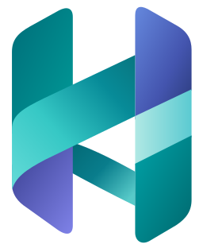
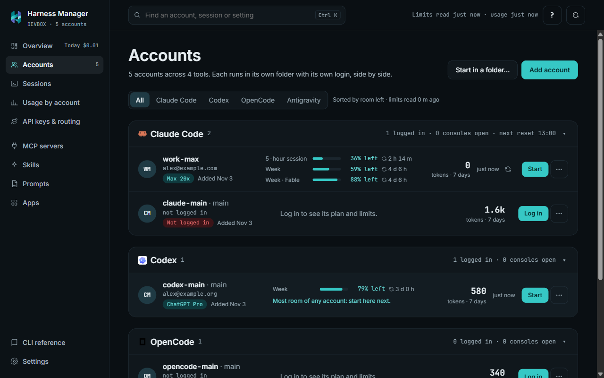
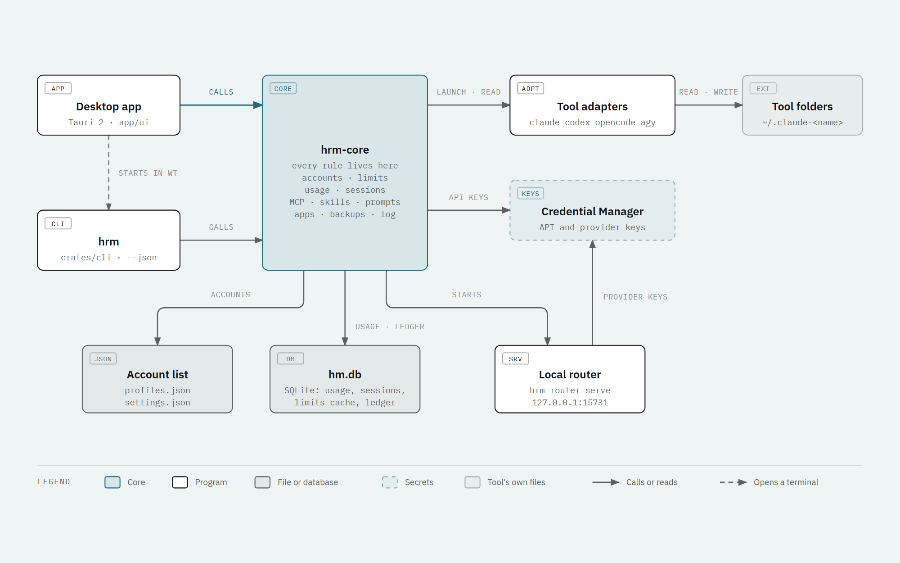

<div align="center">



# Harness Manager

**Run Claude Code, Codex, OpenCode and Antigravity under several accounts on one computer, side by side.**<br>
See every account's limits, usage and sessions in one window, and keep one set of MCP servers, skills and
prompts for all of them.

[](https://github.com/abushanab-net/HarnessManager/releases/latest)
[](https://github.com/abushanab-net/HarnessManager/releases)
[](https://github.com/abushanab-net/HarnessManager/actions/workflows/ci.yml)
[](LICENSE)


[Install](#install) · [Quick start](#quick-start) · [Features](#features) · [Supported tools](#supported-tools) ·
[Command line](#command-line) · [FAQ](#faq) · [Contributing](#contributing)



</div>

## Why

Tools like Claude Code keep one login per settings folder. With a work subscription, a personal one and an
API key, switching means logging out and in, and you lose track of which account still has room.

- **One folder per account.** Every account runs in its own folder, so several run in parallel and nothing
  global changes.
- **Know where the room is.** The 5-hour and weekly limits of every account, when they free up, and which
  account to start next.
- **One place for your setup.** MCP servers, skills and prompts are kept once and written into every tool
  in that tool's own format.
- **A window and a CLI.** Everything the desktop app does, `hrm` does from a terminal, with `--json` for
  scripts.

## Install

Download the installer from the [latest release](https://github.com/abushanab-net/HarnessManager/releases/latest).

| System | File | Notes |
|---|---|---|
| **Windows 10/11** | `Harness.Manager_<version>_x64-setup.exe` | Supported and tested. Installs `HarnessManager.exe` and `hrm.exe` for the current user. |
| macOS (Apple silicon) | `Harness.Manager_<version>_aarch64.dmg` | Built but untested. Drag the app into Applications. Signed with a Developer ID and notarized by Apple. |
| Linux | `.AppImage` or `.deb` | Built but untested. |

API keys can only be saved on Windows for now, because macOS and Linux have no credential store wired in yet.

Silent install on Windows:

```powershell
& ".\Harness.Manager_1.0.0_x64-setup.exe" /S /D="$env:LOCALAPPDATA\Harness Manager"
```

The app updates itself: it checks for a new version at launch and once a day, and installs only updates
signed by the release key.

## Quick start

1. **Start Harness Manager.** It adds a main account for each tool it finds installed.
2. **Accounts → Add account:** name it, pick the tool and sign in. Claude accounts sign in inside the app.
3. **Start** opens a terminal as that account. **Start in a folder** picks a project first.
4. **Overview** shows the live routes, every limit on one seven-day line, and which account has the most room.
5. **MCP servers**, **Skills** and **System prompts:** add something once and tick the tools it should reach.

Press `Ctrl K` to find an account, session or setting. The **?** button replays the page's tour.

## Features

- **Accounts per tool, each in its own folder:** Claude Code (`CLAUDE_CONFIG_DIR`), Codex (`CODEX_HOME`)
  and OpenCode (`XDG_CONFIG_HOME` / `XDG_DATA_HOME`) accounts run in parallel. Antigravity keeps one login,
  so starting another Antigravity account swaps the saved login. Accounts can be renamed and are grouped by
  tool.
- **Limits:** Claude limits come from the numbers Claude Code saves, and can optionally be read live with
  the saved login while it is valid. Codex limits come from its session logs. One timeline shows when every
  limit frees up, and an API-key account can have a daily spending cap.
- **Usage, on Accounts:** each account's tokens per day, its tokens and cost for the last 7, 14 or 30 days
  beside its limits, the split by model, and a CSV export; the Overview adds a heatmap and a request log.
  Each account's own logs are read once and counted once.
- **Projects:** every folder your tools ran in, with its sessions, tokens and cost at API list prices, a
  distribution of where the tokens and the cost went, and a card per project. Pin a project to the sidebar;
  open one to see only its sessions.
- **Sessions:** every tool's sessions in one place, grouped by project, date, account, tool or tag, with a
  project rail beside the list and the running ones pinned at the top; the live count in the sidebar and the
  top bar lead straight to them. Tag sessions and projects with your own labels. A reading view shows the
  steps, failed commands, answers and changed files, and follows a running session live. Resume reopens a
  session in its own account.
- **MCP servers, skills and prompts, kept once:** each MCP server is written into every tool you tick.
  Skills live once in `~\.agents\skills` and are linked into each tool; Discover installs skills from
  GitHub repositories. A ledger records what Harness Manager wrote, so it only ever removes its own entries.
- **Apps:** every copy of each tool on this computer and how it was installed (the vendor's installer, npm,
  winget, Homebrew, Scoop or Chocolatey), its version and the newest one from its vendor, and install, update
  or remove a duplicate copy in a terminal you can watch.
- **API keys and a local router:** API-key accounts keep their key in Windows Credential Manager, and only
  the launched process receives it. A local router on 127.0.0.1 sends routed accounts to providers, moves to
  the next one when a provider fails, and converts between the Anthropic Messages and OpenAI Chat Completions
  formats. Subscription logins never pass through it.
- **Backups:** automatic and manual, of the account list, settings, what Harness Manager wrote into each
  tool, and the skills it manages. Backups never hold keys or logins.
- **Desktop comforts:** closes to the tray, launches at sign-in, dark or light or as Windows is, a
  diagnostic log, and a guided tour of each page.

## Supported tools

| | Claude Code | Codex | OpenCode | Antigravity |
|---|:---:|:---:|:---:|:---:|
| Several accounts at once | ✓ | ✓ | ✓ | one at a time |
| Subscription login | ✓ | ✓ | ✓ | ✓ |
| API-key account | ✓ | ✓ | | |
| 5-hour and weekly limits | ✓ | ✓ | | |
| Tokens and cost | ✓ | ✓ | ✓ | |
| Sessions | ✓ | ✓ | ✓ | ✓ |
| MCP servers and skills | ✓ | ✓ | ✓ | ✓ |
| Prompt file | `CLAUDE.md` | `AGENTS.md` | `AGENTS.md` | `GEMINI.md` |

To add a tool, write an adapter in `crates/core/src/harness/` next to `claude.rs` and `codex.rs`.

## Command line

`hrm` does everything the app does. Add `--json` for scripts.

```powershell
hrm list                                   # accounts, plans, limits, tokens, open consoles
hrm add work --email you@example.com       # a Claude Code account (signs in)
hrm add codex-personal --harness codex
hrm run work                               # Claude Code as that account, in this console
hrm start work --cwd D:\Projects\my-app     # ... in a new terminal
hrm sessions --group project               # --open for the running ones, --project <key>, --tag <tag>
hrm projects list --days 7                 # sessions, tokens and list-price cost per project
hrm tag session work/<session id> release  # or: hrm tag project <key> client-x
hrm usage --days 7 --json
hrm mcp list; hrm skills list
hrm help <command>
```

## FAQ

**Where are my logins and keys?** Logins stay where each tool saved them, in that account's folder.
Harness Manager never refreshes, copies or stores a subscription login. API keys are in Windows Credential
Manager, never in files, command-line arguments, logs or backups.

**What does it store?** `%APPDATA%\HarnessManager` holds `profiles.json` (the account list),
`settings.json`, `hm.db` (usage and sessions), `backups\` and `logs\`. In Settings you can point the account
list at a OneDrive folder to share accounts between computers; keys and logins never leave the computer.

**What goes over the network?** Update checks for Harness Manager (GitHub releases) and for the tools on the
Apps page. Live Claude limits are off unless you turn them on. The router only sends what an API-key account
asks it to send.

**Does it change my existing setup?** It adds its own entries and records them in a ledger. It never removes
your own MCP servers, skills or settings.

**I used the old `claude-accounts.ps1` launcher.** Its accounts are imported on first start.

## How it works



The app and `hrm` are thin; all the rules are in `hrm-core`, so the window and the command line behave the
same. [docs/architecture.md](docs/architecture.md) walks through each part, and these diagrams show the main
flows:
- [Starting an account](docs/diagrams/launch.png): each account gets its own folder through its environment.
- [Shared MCP servers, skills and prompts](docs/diagrams/shared-items.png): kept once, written into each
  tool in its own format, with a ledger of what was written.
- [The local router](docs/diagrams/router.png): failover, the token, and the format conversion.
- [CI and releases](docs/diagrams/release.png): from a pull request to a signed update on every installed copy.

Layout:
- `crates/core`: `hrm-core`, all the rules (tool adapters, accounts, usage, sessions, shared setup, apps,
  backups, the launcher)
- `crates/cli`: `hrm`
- `crates/router`: the local router
- `crates/fakeharness`: the test stand-in for claude, codex, opencode and agy
- `app/`: the Tauri desktop app (`src-tauri`) and its interface (`ui`, plain JavaScript)
- `e2e/`: the desktop app's end-to-end tests
- `scripts/`: build and test

## Contributing

Bug reports and pull requests are welcome. For a security problem, see [SECURITY.md](SECURITY.md) instead.

**Build and test.** You need Rust (stable), Node.js 24 or later, PowerShell 7 and WebView2 (part of
Windows 11).

```powershell
pwsh scripts/build.ps1             # release hrm.exe and the NSIS installer
pwsh scripts/test.ps1              # core, CLI and router tests, then the desktop app UI tests
pwsh scripts/test.ps1 -Installed   # the same, then the UI tests again against the installed app
cd e2e; npm install                # once, for the UI tests (playwright-core)
```

The UI tests (`e2e/app.e2e.mjs`) start the real app in a sandbox, with a fake tool standing in for each
harness, and drive the window over the WebView2 DevTools protocol. Screenshots of every screen land in
`e2e/.work/shots`; `HRM_README_SHOT=1` refreshes the one in this README. The interface in `app/ui` is
built into the app, so run `cargo build -p hrm-app` before running the UI tests on their own.

**Pull requests.**
1. Run `git config core.hooksPath .githooks` once per clone; every push then runs `scripts/test.ps1`.
2. Branch from `develop` (or fork) and open a pull request into `develop`. CI must pass, and a pull request
   needs one approving review.
3. Rules go in `crates/core` with a test; anything visible in the window gets a step in `e2e/app.e2e.mjs`;
   a bug fix comes with the test that would have caught it.
4. Keep the security rules in [SECURITY.md](SECURITY.md). A change that breaks one is not merged.
5. Write commit messages as a short sentence about what the user gets, and keep each change small.

**CI and releases.** `.github/workflows/ci.yml` builds and tests every pull request and every push to
`develop`. Pull requests from forks run on GitHub's own runners. To release, tag a commit on `develop`
(`git tag v1.0.1; git push origin v1.0.1`): `.github/workflows/release.yml` builds Windows, macOS and Linux,
signs the update files and publishes the release with the `latest.json` that installed copies check. Only
maintainers can push release tags.

## License

[MIT](LICENSE). The tool icons in `app/ui/icons` are trademarks of their owners and are used only to name
each tool; see [app/ui/icons/README.md](app/ui/icons/README.md).
