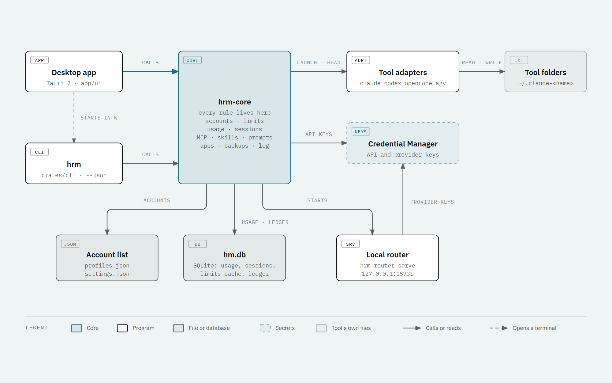
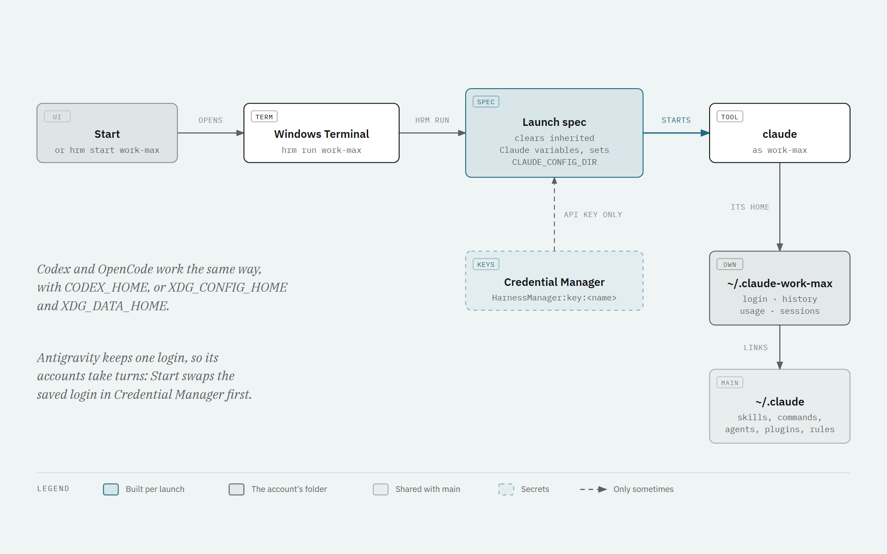
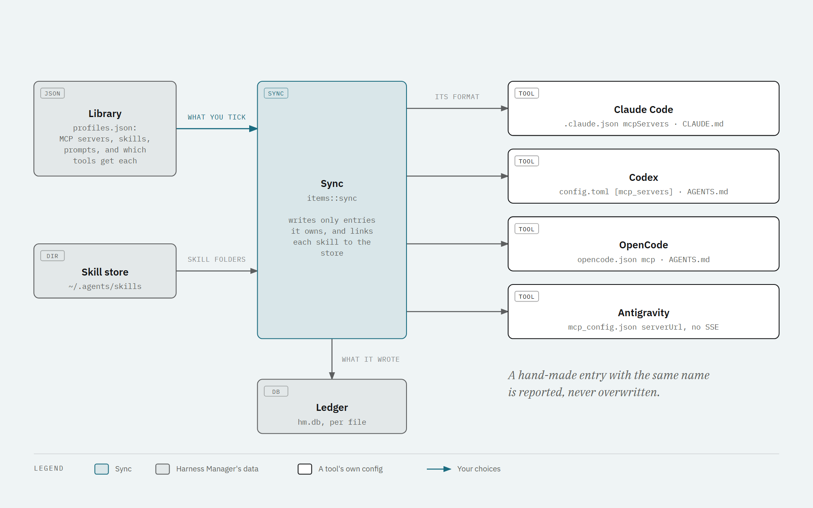
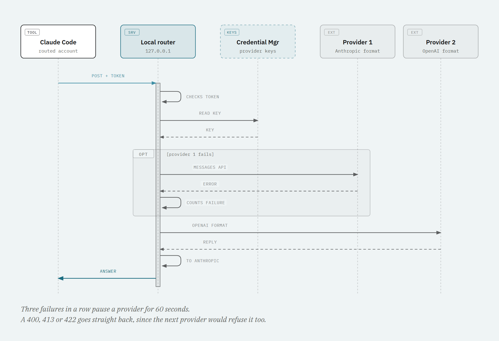
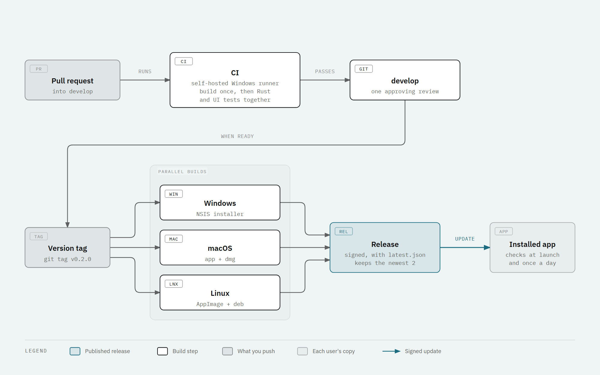

# How Harness Manager works

This page describes Harness Manager as it is built: the parts, where data lives, how an account
starts, how shared MCP servers, skills and prompts reach each tool, the local router, the desktop app,
and how CI and releases run. The README covers install and use.



## The idea: launch, don't switch

Tools like Claude Code keep one login per settings folder. Some account switchers rewrite that one
folder or one global config each time you switch. Harness Manager gives every account its own folder
and starts each console with that folder in its environment. Nothing global changes, so accounts run
side by side, and a crash leaves no tool pointed at the wrong account.

The router follows the same rule: a routed account gets the router's address in its own launch
environment, and no shared file points at the router.

## Words used here

| Word | Meaning | Example |
|---|---|---|
| Tool (harness) | A coding tool Harness Manager runs | Claude Code, Codex, OpenCode, Antigravity |
| Account (profile) | One account of one tool, with its own folder | `work-max` (Claude Code, Max 20x) |
| Kind | How the account pays | `subscription` (the vendor's login), `api_key`, `routed` |
| Main profile | The tool's own default folder, such as `~/.claude` | added on first start for each tool found |
| Provider | An API endpoint, its format and its models, used by routes | an Anthropic or OpenAI-compatible endpoint |
| Route | Providers tried in order (failover) or merged into one model list (aggregate) | `team` |
| Item | Something kept once and written into many tools | an MCP server, a skill, a prompt |

## The parts

| Part | Where | What it does |
|---|---|---|
| hrm-core | `crates/core` | Every rule: accounts, tool adapters, launching, limits, usage, sessions, projects, MCP servers, skills and prompts, apps, backups and the diagnostic log |
| `hrm` | `crates/cli` | Command line over hrm-core. Every command takes `--json` for scripts |
| Router | `crates/router` | The local router. It runs inside `hrm.exe` as `hrm router serve` |
| Desktop app | `app/src-tauri`, `app/ui` | Tauri 2 window, tray and updater. The interface is plain JavaScript |
| Fake tool | `crates/fakeharness` | Stands in for claude, codex, opencode and agy in the tests |

The app and the CLI are thin. The app has one Tauri command, `call(op, args)`, that dispatches to the
same hrm-core functions the CLI uses. Slow operations run off the window's thread. Operations that
change the account list hold a named lock across load, change and save, so the app and `hrm` never
lose each other's change.

`Start` in the app opens a terminal running `hrm run <account>`. The account's key is read inside
`hrm`, so it never appears on a command line.

## Tool adapters

Each tool is one module in `crates/core/src/harness/` behind one trait. The app asks each adapter what it
can do (`caps()`) instead of hard-coding it per tool.

```rust
pub trait Harness: Sync + Send {
    fn id(&self) -> &'static str;
    fn caps(&self) -> Caps;                 // parallel accounts, API keys, limits, usage, sessions, items, routing
    fn home(&self, ctx: &Ctx, p: &Profile) -> PathBuf;   // ~/.<prefix>-<name>, or the default folder for main
    fn prepare(&self, ctx: &Ctx, p: &Profile) -> Result<()>;
    fn launch(&self, ctx: &Ctx, p: &Profile, args: &[String]) -> Result<LaunchSpec>;
    fn login(&self, ctx: &Ctx, p: &Profile) -> Result<LaunchSpec>;
    fn identity(&self, ctx: &Ctx, p: &Profile) -> Identity;   // email, org, plan; never a token
    fn quota(&self, ctx: &Ctx, p: &Profile) -> Option<Quota>;
    fn import_usage(&self, ctx: &Ctx, p: &Profile) -> Result<usize>;
    fn sessions(&self, ctx: &Ctx, p: &Profile, since: i64) -> Result<Vec<SessionMeta>>;
    fn transcript(&self, ctx: &Ctx, p: &Profile, s: &SessionMeta) -> Result<Transcript>;
    fn running(&self, ctx: &Ctx, p: &Profile) -> Vec<RunningConsole>;
    fn item_paths(&self, ctx: &Ctx, p: &Profile) -> ItemPaths;   // where MCP servers, skills and prompts go
    fn activate(&self, ctx: &Ctx, p: &Profile) -> Result<()>;    // for tools with one login slot
    // plus label(), binary(), default_home(), dir_prefix(), resume_args()
}
```

Adding a tool means one module, one line in `harness::all()`, and a stand-in in `crates/fakeharness`.

| Tool | Account folder and environment | Sign-in | Limits | Sessions |
|---|---|---|---|---|
| Claude Code | `CLAUDE_CONFIG_DIR=~/.claude-<name>` | `claude auth login --claudeai`, in the app | `cachedUsageUtilization` in the account's `.claude.json`; live from Anthropic if you turn it on | `projects/**/*.jsonl` |
| Codex | `CODEX_HOME=~/.codex-<name>` | `codex login`, in a terminal | `rate_limits` in its session logs | `sessions/YYYY/MM/DD/rollout-*.jsonl[.zst]` |
| OpenCode | `XDG_CONFIG_HOME` and `XDG_DATA_HOME` under `~/.opencode-<name>`, started with `--standalone` | `opencode auth login`, in a terminal | none | its SQLite database, `opencode.db` |
| Antigravity | One login for all accounts, in Credential Manager (`gemini:antigravity`) | agy's own browser login | none | `conversation_summaries.db`, listed under the main profile |

API-key accounts work for Claude Code (`ANTHROPIC_API_KEY`) and Codex (`OPENAI_API_KEY`). Only Claude Code
accounts can be routed.

Antigravity has one login slot, so its accounts take turns. Each account's login is saved in Credential
Manager under its own name. Starting another account saves the current login back, then swaps the other
one in. Start refuses while Antigravity is open for a different account, because a swap under a running
console would mix the two accounts.

## Where data lives

| Store | What is in it | Where |
|---|---|---|
| Account list | `profiles.json`: accounts, providers, routes, MCP servers, skills, skill repositories, prompts, which tools get each item, and project names | `%APPDATA%\HarnessManager`, or a folder you pick in Settings, such as OneDrive |
| Settings | `settings.json`: terminal, refresh pace, router port, tray, theme, hidden tools, backups, log level | `%APPDATA%\HarnessManager`, per computer |
| Database | `hm.db` (SQLite): usage rows, read cursors, cached limits, the session index, the ledger, the router's request log | `%APPDATA%\HarnessManager`, per computer |
| Backups | One zip per backup | `%APPDATA%\HarnessManager\backups` |
| Diagnostic log | `harness-manager.log`, rolled over at 2 MB | `%APPDATA%\HarnessManager\logs` |
| Keys | API keys (`HarnessManager:key:<account>`), provider keys (`HarnessManager:provider:<id>`), saved Antigravity logins | Windows Credential Manager |
| Logins | Each tool's own login | In the account's folder, where the tool keeps it |

The account list holds no keys and no machine paths, so it can be shared between computers. Each
account's folder is worked out from its name. Keys stay on each computer.

On macOS and Linux there is no credential store yet, so API keys cannot be saved there.

## Starting an account



1. **Start** (or `hrm start <account>`) opens Windows Terminal, or a console window when Windows
   Terminal is not there, running `hrm run <account>`.
2. `hrm run` finds the account and its tool, prepares the folder, and asks the adapter for a launch
   spec: the program, its arguments, variables to set and variables to clear.
3. For Claude Code the spec clears variables that would point it elsewhere (`CLAUDE_CONFIG_DIR`,
   `ANTHROPIC_API_KEY`, `ANTHROPIC_BASE_URL`, `CLAUDE_CODE_USE_BEDROCK` and others), and the markers a
   running Claude Code leaves for its own children. Then it sets `CLAUDE_CONFIG_DIR` to the account's
   folder.
4. An API-key account gets its key from Credential Manager, set in the child process only. A routed
   account gets `ANTHROPIC_BASE_URL` pointing at the router and the router token as
   `ANTHROPIC_AUTH_TOKEN`.
5. The tool runs in that console. Ctrl+C belongs to the tool; `hrm` waits for it to exit.

### What Claude accounts share with the main profile

A new Claude account would otherwise start empty. Harness Manager links it to the main profile
(`~/.claude`), while its login, history and usage stay its own:
- `skills`, `commands`, `agents`, `plugins`, `rules` and `output-styles` are directory junctions to the
  main profile. Junctions need no admin rights.
- `CLAUDE.md` is one line, `@<main CLAUDE.md>`, unless the account wrote its own.
- `settings.json` is merged key by key with the main one. Keys the account changed itself win. Login keys
  and keys that point at another folder are never copied.
- MCP servers in `.claude.json` follow the main list. Only servers this step added are ever removed.
- `projects/` is not linked, so usage stays per account.

## Limits, usage and sessions

- **Limits:** Claude Code saves its own limit numbers in each account's `.claude.json`. Harness Manager
  reads those. With live limits on, it asks Anthropic with the access token Claude Code saved, and only
  while that token is still valid. It never refreshes, copies or stores a login. Codex limits come from
  its session logs. A window whose reset time has passed shows as empty again.
- **Usage:** each tool's logs are read from a saved cursor per file, with a fingerprint of the bytes
  before it, so a rewritten file is read again from the start. Each reply is stored once by its id, per
  account, day, model and project. Prices come from the public models.dev catalog, cached for a day.
- **Sessions:** every adapter lists its sessions and reads a transcript as turns: the prompt, folded steps
  (tool calls, failed commands, file changes) and the answer.
- **Projects:** a session's folder is mapped to its git repository root and keyed by the remote URL,
  so one repository cloned in two places is one project. Folders outside a repository are their own
  project. Names and merges are saved in the account list.
- **Open consoles:** Claude Code leaves a file per running console in the account's `sessions` folder.
  For Codex and Antigravity, Harness Manager looks for their running processes.

The app reads new usage and refreshes limits in the background every few minutes (5 by default), then
tells the window.

## MCP servers, skills and prompts, kept once



The code is in `crates/core/src/items.rs`.
- **MCP servers** are kept in one neutral shape (stdio, http or sse; command, args, env, url, headers).
  Sync writes each one into every tool you ticked, in that tool's format: Claude `mcpServers` JSON,
  Codex `[mcp_servers]` TOML (`headers` become `http_headers`), OpenCode `mcp` entries, and Antigravity
  `mcp_config.json` (`serverUrl`; SSE servers are skipped there because Antigravity does not take them).
- **Skills** live once in `~/.agents/skills`. Each tool's skills folder gets a link to the store's copy.
  Skills come from GitHub repositories (Discover), a local folder, or a tool you import from. Updates come
  from each skill's source.
- **Prompts** are kept per tool. Turning one on writes it into each account's `CLAUDE.md` or `AGENTS.md`.
  Before that, any text in those files that the library does not hold yet is saved into the library, so
  no edit is lost.
- **Targets** say which tool, or which one account, gets each item.
- **The ledger** in `hm.db` records, per file, every entry Harness Manager wrote. Sync only removes
  entries the ledger lists. An entry you made by hand with the same name is reported as a conflict and
  left alone.

Claude accounts other than main get MCP servers and skills through the main profile's links, unless an
item targets that account directly.

## The local router



The router is for API-key providers only. Subscription logins never go through it.
- It listens on `127.0.0.1` only (port 15731 by default) and never on the network, because it adds keys
  to requests.
- Every request must carry the router token, as `Authorization: Bearer` or `x-api-key`. The token is
  random, made once per computer and kept in `hm.db`. Routed launches get it in their environment.
- The endpoints are `/r/<route>/<account>/v1/messages`, `/v1/messages/count_tokens` and `/v1/models`, in
  the Anthropic Messages format.
- **Failover routes** try providers in order. After 3 failures in a row a provider is paused for 60
  seconds, then one request tests it again. A 400, 413 or 422 answer is returned at once, since the
  next provider would refuse the same request.
- **Aggregate routes** merge several providers' models into one list. A model id
  `hm-<provider>--<model>` goes to that provider only, and an unknown provider fails instead of falling
  back to another one.
- Providers in OpenAI format get the request converted to Chat Completions, and the answer converted
  back, streams included (`crates/router/src/convert.rs`).
- Every request is logged with route, account, provider, model, status, time and tokens. `hrm router
  log` shows them.

`hrm run` and the app start the router in the background when a routed account needs it. If another
program already answers on the router port, the start fails and says so, so a routed tool never sends
its token to that program.

## Apps, backups and the diagnostic log

- **Apps** (`apps.rs`): where each tool is installed, its version, and the newest version. Install or
  update runs in a terminal you can watch: npm for npm installs, else the tool's own updater.
- **Backups** (`backup.rs`): one zip holding the account list, settings, the ledger and other saved state,
  and the folders of the skills Harness Manager manages. Caches and the router's process id are left
  out. Keys and logins are never in a backup. An automatic backup runs every 24 hours by default, and
  the newest 10 are kept. Backups can be restored, exported and imported.
- **Diagnostic log** (`log.rs`): the app has no console, so warnings the CLI would print go to
  `logs\harness-manager.log`, at the level set in Settings (warn by default).

## The desktop app

- **Tray:** closing the window hides it to the tray, and the app keeps refreshing until you quit. Only
  one copy runs; opening it again shows the window. Launch at sign-in adds a `Run` key that starts it
  with `--tray`, so the window waits in the tray.
- **Updates itself:** `tauri-plugin-updater` checks `latest.json` on the latest GitHub release at
  launch and every 24 hours. Settings > Updates installs the new version and restarts. The app installs
  only what the release key signed; the public key is in `app/src-tauri/tauri.conf.json`.
- **First start:** a main profile is added for each tool whose folder exists, and accounts from the old
  `claude-accounts.ps1` launcher are imported.

## CI and releases



- **CI** (`.github/workflows/ci.yml`) runs on every pull request and every push to `develop`, except
  changes to documentation only. It builds once, then runs the Rust tests and the UI tests at the same
  time, on the self-hosted Windows runner. Pull requests from forks always run on GitHub's runners.
- **Releases** (`.github/workflows/release.yml`) start when a `vX.Y.Z` tag is pushed. The version comes
  from the tag. Windows (NSIS), macOS (app and dmg) and Linux (AppImage and deb) build at the same time,
  signed for the updater. The release is then published with its `latest.json`, and all but the newest 2
  releases are deleted. Their tags stay.

## Rules every change keeps

Harness Manager handles other people's logins, so these hold for every change:
- Never refresh, copy or store a subscription login. Only read what the tool itself saved.
- API keys live only in Windows Credential Manager. They never go in files, command-line arguments or
  logs.
- Subscription accounts are never routed, never in a failover route and never aggregated.
- The router listens on 127.0.0.1 only and always needs its token.
- Only remove what the ledger says Harness Manager wrote. Never remove a user's own MCP servers, skills
  or settings.
- Usage and sessions carry the account they came from, so numbers stay per account.

## Not done yet

- macOS and Linux builds are made by every release but are untested. They have no credential store yet,
  and the terminal launcher there only tries `x-terminal-emulator`.
- OpenCode and Antigravity show no limits, and Antigravity shows no usage.

## Diagram sources

The diagrams are in `docs/diagrams/`. Each `.html` file is the source, drawn in the app's own colours
(the `harness-manager` theme in `.github/illustration-theme.yml`), with `.svg` and `.png` exports next
to it.
