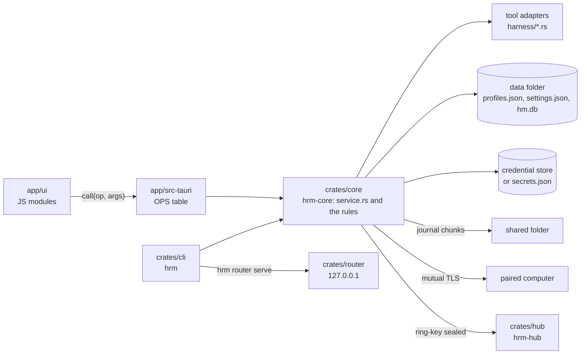

# How Harness Manager works

This page describes Harness Manager as the code builds it today: the crates, the data folder, how an account
starts, where secrets go, how computers share their history, the desktop app and its interface, and the tests.
Each section names the files it describes, so every statement can be checked there. The README covers install
and use.

## The idea: launch, don't switch

Tools like Claude Code keep one login per settings folder. Some account switchers rewrite that one folder or
one global config each time you switch. Harness Manager gives every account its own folder and starts each
console with that folder in its environment. Nothing global changes, so accounts run side by side, and a crash
leaves no tool pointed at the wrong account. A routed account gets the router's address the same way, in its
own launch environment.

## Words used here

| Word | Meaning | Example |
|---|---|---|
| Tool (harness) | A coding tool Harness Manager runs | Claude Code, Codex, OpenCode, Antigravity, Pi, Oh My Pi |
| Account (profile) | One account of one tool, with its own folder | `work-max` (Claude Code) |
| Kind | How the account pays | `subscription` (the vendor's login), `api_key`, `routed` |
| Main profile | The tool's own default folder, such as `~/.claude` | added on first start for each tool found |
| Provider | An API endpoint, its format and its models, used by routes | an Anthropic or OpenAI-compatible endpoint |
| Route | Providers tried in order (failover) or merged into one model list (aggregate) | `team` |
| Item | Something kept once and written into many tools | an MCP server, a skill, a prompt |
| Computer (device) | One installation, with its own id, name and incarnation in `settings.json` | `WORKSTATION` |

## The crates

The workspace (`Cargo.toml`) has six members.

| Crate | Package | What it owns |
|---|---|---|
| `crates/core` | `hrm-core` | Every rule: the tool adapters, the account list, launching, limits, usage, sessions and the session index, projects, MCP servers, skills and prompts, apps, backups, restore, the archive, secrets, the sweep, the journal and the sync transports |
| `crates/cli` | `hrm` | The command line over hrm-core (`main.rs` holds the clap definitions; `router_cmd.rs` the `router` subcommands) |
| `crates/router` | `hrm-router` | The local router; it runs inside `hrm` as `hrm router serve` |
| `crates/hub` | `hrm-hub` | The hub service a computer can sync through (`lib.rs`, `main.rs`); `deploy/hub/` runs it in Docker behind Caddy |
| `crates/fakeharness` | `fakeharness` | The test stand-in, copied under each tool's name; it performs a tool's login and records how it was launched |
| `app/src-tauri` | `hrm-app` | The Tauri 2 desktop app: window, tray, limits popup, updater, background loops |

`crates/core/src/service.rs` holds the operations the app and the CLI share; both call it, and its views are
plain serializable values. `hrm-core`'s modules are listed in `crates/core/src/lib.rs`.

## The data folder

`ctx::data_dir()` in `crates/core/src/ctx.rs`: `HRM_HOME` when set, else `HarnessManager` in the platform's data
folder (`%APPDATA%` on Windows, `~/Library/Application Support` on macOS, `$XDG_DATA_HOME` or
`~/.local/share` on Linux). Account folders are created under the user's home, or under `HRM_PROFILES_HOME`
when set.

| File | What is in it | Code |
|---|---|---|
| `profiles.json` | The account list: accounts, providers, routes, MCP servers, skills, skill repositories, prompts, targets, project names. Format version 2. Each MCP env and header value is written as `null` once the credential store holds it. The file can live elsewhere (`registry_path` in settings), for example a OneDrive folder | `registry.rs` |
| `settings.json` | This computer's settings: terminal, refresh pace, router port, theme, text size, backups, the log, the computer's id, name and incarnation, the sync mode, folder and hub address, the archive | `ctx.rs` (`Settings`) |
| `hm.db` | SQLite: usage rows and read cursors, limits and their history, the session index (`sessions`, `sessions_fts`), the ledger, tags, the router's log, the journal outbox, the other computers and their cursors | `db.rs` |
| `backups/` | One zip per backup | `backup.rs` |
| `logs/harness-manager.log` | The diagnostic log, rolled over at 2 MB | `log.rs` |
| `secrets.json` | Off Windows only, when no system credential store answers; see Secrets | `secrets.rs` |
| `device.crt` | This computer's certificate for the direct connection | `sync/peer/identity.rs` |
| `journal-cache/` | The published chunks of this computer and of every origin it received, for relay | `sync/peer/store.rs` |
| `transcripts/` | Transcripts fetched from other computers | `transcripts.rs` |

Writes go through `util::write_atomic` (a temporary `<file>.hrm-tmp-<pid>-<n>`, then a rename). Code that loads,
changes and saves the account list holds a named lock across the three (`Ctx::lock_registry`), so the app and
`hrm` never lose each other's change. The skill store is `~/.agents/skills` (`items::skill_store`).

## Tool adapters

Each tool is one module in `crates/core/src/harness/` behind the `Harness` trait in `harness/mod.rs`:
`claude.rs`, `codex.rs`, `opencode.rs`, `agy.rs` (Antigravity), `pi.rs` (Pi, and the session parser Oh My Pi
shares) and `omp.rs`. The trait gives each tool's capabilities (`caps()`), its account folder (`home()`,
`~/.<prefix>-<name>` or the default folder for main), a launch spec and a login spec, identity, limits, usage
import, session folders, sessions and transcripts, running consoles, where MCP servers, skills and prompts go
(`item_paths()`), `activate()` for a tool with one login slot, and `materialize()` for resuming a session from
another computer. `harness::all()` lists the six adapters; adding a tool is one module and one line there.

| Tool | Account folder and environment | Limits | API key / routed |
|---|---|---|---|
| Claude Code | `CLAUDE_CONFIG_DIR=~/.claude-<name>` | `.claude.json`'s saved numbers; live from Anthropic when turned on | both |
| Codex | `CODEX_HOME=~/.codex-<name>` | `rate_limits` in its session logs | API key |
| OpenCode | `XDG_CONFIG_HOME` / `XDG_DATA_HOME` under `~/.opencode-<name>`, `--standalone` for every account but main | none | neither |
| Antigravity | One login slot for the computer; accounts take turns (`agy.rs`) | `agy -p /usage`, signed-in account only | neither |
| Pi | `PI_CODING_AGENT_DIR` | none | both |
| Oh My Pi | `PI_CODING_AGENT_DIR` | none | neither |

Antigravity keeps its login in the credential store under one name. On Windows, starting another account saves
the login in the slot back to its owner and puts the other account's copy in (`agy::can_swap()` is
`cfg!(windows)`); Start refuses while Antigravity runs for a different account. On macOS and Linux it runs as its
main account only.

## How a start works

`crates/core/src/service.rs` (`start`, `launch_spec`), `crates/core/src/launch.rs`, and the adapter's `launch`.

1. **Start** in the app, or `hrm start <account>`, opens a terminal running `hrm run <account>`
   (`launch::open_terminal`). On Windows that is Windows Terminal, or a console window when the terminal
   setting says so or `wt` is missing; on macOS a Terminal window opened with a `.command` file; elsewhere
   `x-terminal-emulator`.
2. `hrm run` loads the account and its adapter, calls `prepare()` (creates the folder; for a Claude account
   other than main, links it to the main profile, see below), calls `activate()` when the tool cannot run
   accounts in parallel, and asks the adapter for a `LaunchSpec`: the program, its arguments, variables to set
   and variables to clear.
3. For Claude Code the spec clears the variables that would point it elsewhere (`CLAUDE_CONFIG_DIR`,
   `ANTHROPIC_API_KEY`, `ANTHROPIC_AUTH_TOKEN`, `ANTHROPIC_BASE_URL`, `CLAUDE_CODE_USE_BEDROCK` and others) and
   the markers a running Claude Code leaves for its children, then sets `CLAUDE_CONFIG_DIR` to the account's
   folder.
4. An API-key account gets its key from the credential store, set in the child process only. A routed account
   gets `ANTHROPIC_BASE_URL` pointing at `http://127.0.0.1:<port>/r/<route>/<account>` and the router token as
   `ANTHROPIC_AUTH_TOKEN`; `service::router_endpoint` starts the router first when it is not running.
5. The tool runs in that console; `hrm` waits for it to exit. The key never appears on a command line.

**What a Claude account shares with the main profile** (`crates/core/src/shared.rs`): `skills`, `commands`,
`agents`, `plugins`, `rules` and `output-styles` are links to the main profile's folders (junctions on Windows,
symlinks elsewhere); `CLAUDE.md` is one `@<main CLAUDE.md>` line unless the account wrote its own; `settings.json`
is merged key by key with the main one, login keys and keys that point at another folder never copied; MCP
servers in `.claude.json` follow the main list. `projects/` is not linked, so usage stays per account.

## Secrets

`crates/core/src/secrets.rs`. Every secret is a named credential: `HarnessManager:key:<account>` (API keys),
`HarnessManager:provider:<id>` (router provider keys), `HarnessManager:mcp:<server>:env|header:<name>` (MCP
values), `HarnessManager:agy:<account>` (saved Antigravity logins, `harness/agy.rs`),
`HarnessManager:device-key:<id>` (the direct connection's signing key, `sync/peer/identity.rs`),
`HarnessManager:ring-key:<id>` and `HarnessManager:hub-token:<id>` (`sync/hub.rs`). `HRM_CRED_PREFIX` replaces
`HarnessManager` for tests.

- **Windows:** Credential Manager generic credentials, through the Win32 API, behind a named lock with a
  read-back after each write. There is no file fallback on Windows.
- **macOS and Linux:** the `keyring` crate (the Keychain; the Secret Service, as GNOME Keyring or KWallet serve
  it). A probe at the first use decides; when the store cannot be reached, or fails later in the process, the
  secrets go into `secrets.json` in the data folder, written with owner-only permissions, values base64-encoded
  and not encrypted. A value found in the file is moved into the store when a process that reaches the store
  reads it. Under a test prefix the file is used alone, never the real Keychain or Secret Service.
- `hrm secrets check` writes, reads back and deletes a probe credential and names the store in use.
- **MCP values** (`registry.rs`, `Registry::write`): on save each env and header value goes to the store and
  the list keeps the key with `null`. A value the store refuses stays in `profiles.json`, with a warning in the
  log. On load, `null` is filled from the store, or left empty on a computer that has none. Backups carry the
  list with every value removed (`backup.rs`, `without_mcp_values`).
- Older versions kept the device key, ring key and hub token as files (`device.key`, `ring.key`, `hub.token`);
  `secrets::read_moving` moves such a file into the store and deletes it once the store holds the value.
- The router token is not a credential: it is made once per computer and kept in `hm.db`
  (`service::router_token`), and backups leave it out.

## Limits, usage and sessions

- **Limits:** Claude Code saves its own limit numbers in each account's `.claude.json`; with live limits on,
  `harness/claude.rs` asks Anthropic with the access token Claude Code saved while it is valid, and never
  refreshes, copies or stores a login. Codex limits come from its session logs. Antigravity's come from running
  `agy -p /usage` for the signed-in account (`agy.rs`, called from `service::refresh_quotas`).
- **Usage:** each tool's logs are read from a saved cursor per file. Each reply is stored once by its id.
  Prices come from the public models.dev catalog, cached for a day (`pricing.rs`).
- **The session index** (`index.rs`): the `sessions` table is what the pages read; `index::refresh` is the only
  code that walks the tools' folders. `watch.rs` watches the session folders with the `notify` crate and puts a
  changed file into the index within about a second; the periodic refresh is the safety net.
- **Projects** (`projects.rs`): a session's folder is mapped to its git repository root and keyed by the remote
  URL, so one repository cloned in two places is one project.

## MCP servers, skills and prompts

`crates/core/src/items.rs`. MCP servers are kept in one neutral shape (stdio, http or sse) and written into
every ticked tool in its format (Claude JSON, Codex TOML, OpenCode JSON, Antigravity's `mcp_config.json`).
Skills live once in `~/.agents/skills` and each tool's skills folder links to the store's copy. Prompts are
written into each account's prompt file. The ledger in `hm.db` records every entry Harness Manager wrote, and
sync removes only those; a hand-made entry with the same name is reported as a conflict and left alone.

## The local router

`crates/router/src/lib.rs` and `convert.rs`. It listens on `127.0.0.1` only (port 15731 by default), and every
request must carry the router token. Failover routes try providers in order; after 3 failures in a row a
provider is paused for 60 seconds, and a 400, 413 or 422 answer is returned at once. Aggregate routes pick the
provider from a `hm-<provider>--<model>` id and never fall back. Providers in OpenAI format get the request
converted to Chat Completions and the answer converted back, streams included. Subscription logins never pass
through it.

## Across computers: the journal and three transports

`crates/core/src/journal.rs` and `crates/core/src/sync/`. The sync mode in settings is `off`, `folder` or
`hub`; the direct connection is a separate switch that works beside either.

**The journal.** While sync or the direct connection is on (`Ctx::open_at` in `ctx.rs`), each change on this computer is appended to the `outbox` table in the same
transaction as the change. `journal::publish` cuts unpublished entries into chunk files of up to 1 MB, each
named by incarnation and sequence range, hashed with SHA-256 and signed with this computer's Ed25519 key, and
keeps them in the local store (`sync/peer/store.rs`). Merging another computer's chunks checks the hash and,
once its key is known, the signature, and applies them in order with a cursor per origin and incarnation
(`journal::apply_manifest`). The entry kinds (`journal::apply`):

| Kind | Carries |
|---|---|
| `usage` | One model response with its request id and the cost it was valued at; merged by id, so never counted twice |
| `session` | A session's index row, keyed `<tool>/<account>/<id>`; a session this computer holds as its own is never taken over |
| `quota` | One limit reading |
| `tag` | The tags of a session or a project |
| `transcript` | A carried transcript's entry; the file is fetched when the session is read or resumed here |
| `tombstone` | The removal of a session, tag or transcript (never of usage) |

An entry of a kind this version does not know stops that computer's merge just before it, and its card asks for
an update. Names that arrive from another computer are checked before they become paths.

Three rules sit on top of the entries:

- **Tags:** the `tag_times` table keeps the time and computer of each item's last tag change. A merged change
  applies only when it is later, and the computer's id decides between equal times, so two computers that tagged
  the same item before syncing end with the same tags.
- **Presence** is stamped with this computer's clock when it arrives, so "running on another computer" does not
  depend on the other computer's clock.
- **Missing entries:** a relay keeps the newest 50 MB of another computer's journal and the hub drops old
  chunks. A chunk list that starts past the cursor is taken all the same, and the range passed is kept on that
  computer's row; its card then says that part of its history is missing here.

This computer's own chunk files are kept whole. Chunks older than the newest 100 are joined into files of up to
1 MB, one run per publish; a reader skips the entries its cursor is past, so a reader of any version takes a
joined file as an ordinary chunk. One writer changes a chunk list at a time (a named lock per origin), and a
listed chunk whose file is gone is cut again from the outbox.

**The shared folder** (`sync/folder.rs`): one folder per computer under `devices/<id>/`, holding its journal
chunks and manifest, `device.json` and `presence.json`. Nothing in it is encrypted; the folder is the owner's.

**The direct connection** (`sync/peer/`): paired computers talk HTTPS with mutual TLS on `listen_port`, each
pinning the other's certificate (`listener.rs`, `client.rs`). They find each other by mDNS
(`_hrm._tcp.local.`, `mdns.rs`) or at an address the owner gives, pull each other's journals and presence every
ten seconds, and relay the journals of computers they both know. Pairing (`pairing.rs`) uses a six-digit code
as the password of a SPAKE2 exchange; the two identity payloads travel encrypted with the key it derives, and
three wrong tries or two minutes end it.

**The hub** (`sync/hub.rs` on the client, `crates/hub` for the service): every computer pushes its chunks to
the hub and pulls the others', with presence, transcripts and rendezvous addresses for the direct connection.
Chunks, presence and transcripts are sealed with the ring key, a 32-byte secret shared by the owner's computers
(carried in the pairing payload, or typed as the recovery key), so the hub stores what it cannot read; the
signed device records are plain. Each request carries a bearer token: the admin token for the first join, a
per-computer token minted at join and stored hashed after that. While the app runs, `hub::watch` keeps the
hub's events socket open and runs a round on each change, with a round every 30 s as the fallback. The service
keeps SQLite at `<data>/hub.db` and the bytes under `<data>/blobs/` (`crates/hub/src/lib.rs`); its settings come
from `HUB_ADMIN_TOKEN`, `HUB_DATA`, `HUB_BIND`, `HUB_MAX_BLOB_MB` and `HUB_RETAIN_MB` (`main.rs`).

**Transcripts** (`sync/transcripts.rs`, `transcripts.rs`): with Carry transcripts on, changed session files
travel compressed with a `transcript` entry; another computer fetches one when it reads or resumes the session,
and `Harness::materialize` copies it where the tool looks, so resuming is a fork and the original is never
written.

## The sweep

`crates/core/src/sweep.rs`. Harness Manager names its own temporary files (`write_atomic`'s
`.hrm-tmp-<pid>-<n>`, a backup's `.zip.part`, a skill's `.<name>.new` and `.<name>.old`, the skill download
staging folder, the macOS `.command` files). The sweep removes only those names, only once they are an hour
old, only in folders Harness Manager writes to, and never through a link; a skill replacement that stopped
halfway is put right. The app runs it from its background loop at the first round and then at most once an
hour (`sweep::hourly`); `hrm cleanup [--dry-run]` runs it by hand.

## The desktop app

`app/src-tauri/src/main.rs` and `ops.rs`.

**One command door.** The window has one Tauri command, `call(op, args)`. Three operations need the window's
handle and are answered there (`self_update_check`, `self_update_install`, `open_main`); every other name is
looked up in `OPS`, the operations table in `ops.rs`, which gives each its handler and flags. The handlers are
split by area: `accounts.rs`, `usage.rs`, `sessions.rs`, `computers.rs`, `setup.rs`, `settings.rs`. A new
operation is one line in the table and one function in its area's module. Calls run off the window's thread.

The flags: `NO_LOCK` runs without the account list's lock (for slow calls that only read it); `NO_CHANGE` marks
a call that changes nothing the pages show, and any other call drops the kept page answers; `PAGE` marks the
call a page opens with, answered at once from the kept answer while no new data has arrived, and redone in the
background when it is older than 10 seconds. The tests in `ops.rs` check that no operation is listed twice and
that every `call('…')` in `app/ui/*.js` names an operation in the table.

**Background loops** (`main` in `main.rs`): every `refresh_minutes` (5 by default) a round imports usage,
refreshes limits, makes an automatic backup when one is due, runs the sweep (hourly) and the archive (daily),
refreshes the session index and runs a sync round when sync is on, then emits `refreshed`. Presence and the
open sessions are updated every minute; the folder watcher emits `refreshed` when a session file changes; the
direct connection ticks every ten seconds; the hub watcher holds the events socket; the self-update check runs
at launch and every hour.

**Tray and updates.** Closing the window hides it to the tray when `close_to_tray` is on; one copy runs at a
time. A click on the tray icon opens the limits popup (`limits.html`, `popup.js`). `tauri-plugin-updater`
installs only updates signed by the release key. Launch at sign-in writes a `Run` key on Windows and is not
available elsewhere (`launch.rs`, `autostart`).

## The interface

`app/ui/`, plain JavaScript modules with no build step and no framework.

- `index.html` loads `app.js`, which imports one module per page: `home.js` (Overview), `sessions.js`,
  `projects.js`, `accounts.js`, `computers-page.js`, `mcp.js`, `skills.js`, `prompts.js`, `routing.js`,
  `apps.js`, `cli.js`, `settings.js`; plus `computers.js` (the top-bar chip and the pairing, hub and recovery-key
  dialogs), `guide.js` (the page tour), `restore.js` and `resume.js` (their dialogs), `palette.js` (the command
  palette on `Ctrl K`) and `pane.js` (the detail pane Sessions and Accounts share).
- `limits.js` draws the limit ring and the account summary. It imports no page, so the tray popup (`popup.js`)
  loads it alone; `accounts.js` re-exports its names for the pages.
- `core.js` is the shared runtime: backend calls, app state, the hash router (`view(name, render)`), the render
  queue, the keyed reconciler, the one dialog controller, the menu, notices and the theme. `lib.js` holds
  helpers (escaping, formatting, icons, charts, Markdown). `parts.js` holds the parts every page shares: the page
  names, the page head (the name and one status sentence), the segmented choice, the pill, and the rule for an
  account that needs attention.
- Styles: `app.css` for the shell and shared parts, then one stylesheet per page group: `pages-overview.css`,
  `pages-sessions.css`, `pages-accounts.css`, `pages-setup.css`, `pages-system.css`, `pages-settings.css`, `pages-palette.css`.
- **Redraw model.** Renders run one after another, and a burst of requests collapses into one. A page draws
  with `patch(sheet, html)`: the reconciler matches children by id, `data-key` or `data-testid` and keeps scroll
  positions, focus, the caret and fields the reader is editing. When the backend emits `refreshed`, `app.js`
  redraws the Overview, Accounts, Projects and Sessions in the background, at most one redraw at a time and at
  least four seconds apart; a window hidden in the tray draws once when it is shown again.
- **Text size** (`text_size`: compact, comfortable, large) zooms the whole window to 0.92, 1 or 1.12
  (`applyTheme` in `core.js`); the tray popup keeps one size.

## Testing

- **Rust:** `cargo test --workspace`. hrm-core has unit tests beside the code and integration tests in
  `crates/core/tests/`; the CLI's end-to-end tests are `crates/cli/tests/e2e.rs`, the router's
  `crates/router/tests/router_e2e.rs`, the hub's `crates/hub/src/tests.rs`; the sync tests run two or three
  computers in temp folders (`sync/peer/tests.rs`, `sync/hub_tests.rs`).
- **Test switches** (`crates/core/src/testenv.rs`): environment variables that point Harness Manager at a mock
  server, a fake tool, a recorded terminal or a test credential prefix (`HRM_CRED_PREFIX`, `HRM_UPDATE_URL`,
  `HRM_DEVTOOLS_PORT`, `HRM_TERMINAL_LOG`, `HRM_AUTOSTART_KEY`, `HRM_GITHUB_CODELOAD`, `HRM_ANTHROPIC_USAGE_URL`,
  `HRM_AGY_CRED`, `HRM_EXE`). They are read only through `testenv::var`, which honours them in a debug build, in
  the crate's own tests, or when `HRM_HOME` is set.
- **UI:** `e2e/app.e2e.mjs` starts the real app in a sandbox (its own data and home folders, fake tools, a
  private credential prefix) and drives it with `playwright-core` over the WebView2 DevTools protocol; it
  checks behaviour. `e2e/design.e2e.mjs` holds the design rules (shell sizes, type scale, the page head, each
  page's measured parts) and runs in the same window. `HRM_E2E_SYNC`, `HRM_E2E_PEERS` and `HRM_E2E_HUB` add the
  across-computers tests; `HRM_E2E_ONLY` and `HRM_E2E_REPEAT` narrow a run; `HRM_E2E_APP_DIR` drives an
  installed copy.
- `scripts/test.ps1` builds, runs every Rust test, then the UI suite with the three across-computers switches;
  `-Installed` also builds the installer, installs it into a temp folder, runs the UI suite against it and
  uninstalls it.

## CI and releases

`.github/workflows/ci.yml` runs on pull requests and pushes to `develop` that change more than documentation.
The Windows job builds once and runs the Rust tests and the UI suite in parallel; the macOS job checks the
workspace builds and runs the tests of `hrm-core` and `hrm-hub`; the Linux job runs the same tests. Each job runs
on a self-hosted runner named by a `RUNNER_*` repository variable and fails when the variable is missing; a pull
request from a fork runs on GitHub-hosted runners instead, so outside code never runs on the project's machines.

`.github/workflows/release.yml` starts on a `vX.Y.Z` tag. It calls `ci.yml` first; only when that passes does it
create a draft release and build Windows x64, Windows ARM64 (cross-compiled, allowed to fail), macOS (`.app`,
then a `.dmg` made with `hdiutil`) and Linux (AppImage and deb) one after the other, because each build rewrites
the release's `latest.json`. The version is taken from the tag and the updater files are signed. The hub's Docker image goes to `ghcr.io` from the `homek8-general` runner. The
release is then published with its `latest.json`, and all but the newest 2 releases are deleted (their tags
stay). When a build fails or is cancelled, the draft is deleted.

## Rules every change keeps

- Never refresh, copy or store a subscription login. Only read what the tool itself saved; the one exception is
  Antigravity's single login slot on Windows, whose copies live in the credential store.
- Keys and secret values live in the credential store (or, off Windows, the private fallback file); never in
  command-line arguments, logs or backups.
- Subscription accounts are never routed, never in a failover route and never aggregated.
- The router listens on 127.0.0.1 only and always needs its token.
- Only remove what the ledger says Harness Manager wrote.
- What another computer, the folder or the hub sends is checked before use, and another computer's journal
  changes only its own rows.

## Not done yet

- macOS and Linux builds are made by every release, but only the core and the hub are tested there. Launch at
  sign-in and the Antigravity account swap are Windows only, and on Linux the terminal launcher tries only
  `x-terminal-emulator`.
- OpenCode, Pi and Oh My Pi show no limits; Antigravity shows no usage.
